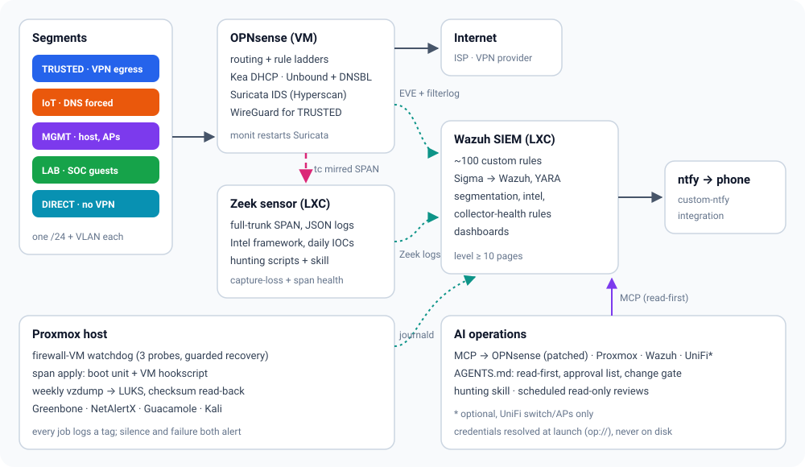
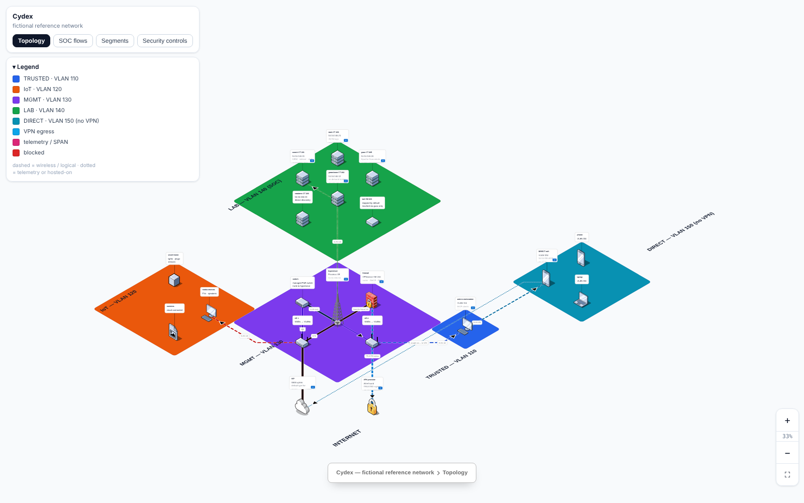
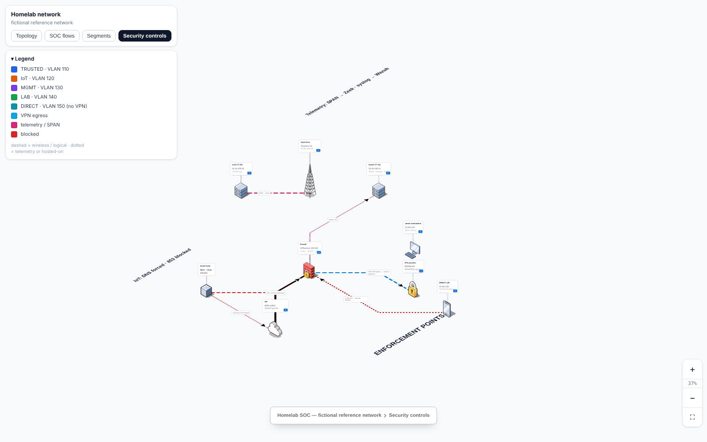

<div align="center">
  
</div>

<h1 align="center">Cydex</h1>

<p align="center"><strong>A segmented home network with a working blue-team stack on one Proxmox host - firewall/IDS, SIEM, network sensor, threat intel, paging, self-healing, encrypted backups, and an AI-operations layer with guardrails.</strong></p>

<p align="center">
  
  
  
  
  
  
</p>

<p align="center">
  <a href="#quick-start">Quick Start</a> |
  <a href="docs/configure.md">Configure</a> |
  <a href="#components">Components</a> |
  <a href="#safety-model">Safety</a> |
  <a href="#documentation">Docs</a> |
  <a href="docs/detection-catalog.md">Detections</a> |
  <a href="docs/lessons-learned.md">Lessons</a>
</p>

[](docs/img/architecture.svg)

Every address, ID and device in this repo belongs to a **fictional reference network**.
[`tools/localize.py`](docs/configure.md#2-localize-the-repo) rewrites them to yours in one step.

## Why I built Cydex

For years, I put my energy into cybersecurity and threat intelligence professionally. Then I’d come home after a long day and use the modem and router my ISP provided without thinking twice about it. Network visibility, IoT segmentation, firewall policies—all things I advocated for at work—weren’t getting the same attention on my own network.

Once I started digging into my home setup, I became frustrated with how little visibility and control the equipment gave me. I wanted to understand what my devices were doing, separate them appropriately, and verify that my security controls actually worked. So I decided to build it myself using open-source tools.

Cydex grew out of that effort. This repository shares the architecture, configurations, automation, and lessons learned in a fictional reference environment that others can study and adapt.

This is definitely not for everybody. It assumes you’re comfortable with networking, writing firewall rules, and troubleshooting when something breaks. It takes ongoing maintenance, and a mistake can disrupt your home network. If you’re looking for a plug-and-play security appliance, this isn’t one.

If you want to understand and take responsibility for how your network is secured, I hope the work here gives you a useful starting point—including the mistakes and limitations, not just the finished diagrams.

## What makes it different

| Priority | How the repo handles it |
| --- | --- |
| Detection that pages for the right things | ~100 custom Wazuh rules: segmentation violations, Zeek IOC matches by confidence, Sigma-converted Zeek rules, YARA, and collector health - tuned around one paging threshold |
| Sensors that stay honest | SPAN mirror re-applied at boot and on VM restart, verified, and alerted on; capture-loss *and* total-blindness detection |
| Self-healing with limits | Firewall watchdog needs three independent probes to fail, with cooldown and a daily cap; monit restarts Suricata only on runaway memory |
| Backups you can trust | Weekly encrypted vzdump, checksums recorded once, every archive re-read, failure pages with the reason |
| AI access with guardrails | MCP servers for OPNsense, Proxmox and Wazuh (UniFi optional), plus an agent policy (`AGENTS.md`): read-first, approval list, change gate |
| One config file | `config/homelab.env` + `tools/localize.py` set addresses, VLANs and guest IDs everywhere |
| Safe to publish | `tools/check.sh` and `tools/export-release.sh` gate releases: secrets, private patterns, git objects, images |

## Quick Start

1. **Check prerequisites** - one x86 host with 2 NICs (8+ cores, 24 GB+ to run everything),
   a managed switch, multi-SSID APs. Any vendor works: see the
   [hardware table](docs/setup/00-prerequisites.md#hardware) and the
   [reference build](docs/setup/00-prerequisites.md#reference-build-what-this-repo-runs-on)
   this repo runs on.
2. **Make it yours**
   ```bash
   git clone https://github.com/cyworxs-prez/Cydex.git cydex
   cd cydex
   umask 077
   test -f config/homelab.env || cp config/homelab.env.example config/homelab.env
   # Edit config/homelab.env with your own subnets, VLANs, IPs and guest IDs FIRST.
   python3 tools/localize.py                            # preview; no files changed
   python3 tools/localize.py --apply                    # writes them into rules, configs, scripts, map
   python3 tools/localize.py --check                    # OK - every file matches
   ```
   Use a private deployment copy: localization writes your network details into tracked
   files. Do not push those changes to a public fork.
   Then set the credentials, host-side files and schedules listed in
   [docs/configure.md](docs/configure.md).
3. **Build the base** - [Proxmox](docs/setup/01-proxmox.md) -> [OPNsense + VLANs](docs/setup/02-opnsense.md) -> [switch / Wi-Fi](docs/setup/03-switching-wifi.md).
4. **Add the SOC** - [Wazuh](docs/setup/04-wazuh.md) -> [Zeek](docs/setup/05-zeek.md) -> [self-healing + backup](docs/setup/06-resilience.md) -> [Greenbone](docs/setup/07-greenbone.md).
5. **Turn on automation only after its check passes** - [configure.md §5](docs/configure.md#5-before-enabling-any-automation).
6. **Optional** - [AI operations](docs/setup/08-ai-ops.md), [network map](docs/setup/09-network-map.md), [NetAlertX](docs/setup/10-netalertx.md), [Guacamole](docs/setup/11-guacamole.md).

## Components

### Edge and segmentation

| Component | Built on | What this repo adds | Guide |
| --- | --- | --- | --- |
| Hypervisor | [Proxmox VE](https://www.proxmox.com/en/proxmox-virtual-environment) | VLAN-aware bridge layout, guest plan, helper scripts that run code in guests without quoting bugs | [01](docs/setup/01-proxmox.md) |
| Firewall / router | [OPNsense](https://github.com/opnsense/core)  | Per-segment rule ladder, forced DNS for IoT, DoT/DoQ block, VPN egress for one segment only | [02](docs/setup/02-opnsense.md) |
| IDS | [Suricata](https://github.com/OISF/suricata)  | Memory-safe settings (Hyperscan + Low profile), monit restart, EVE to Wazuh | [02](docs/setup/02-opnsense.md#26-suricata-ids) |
| Wi-Fi / switching | any 802.1Q gear ([hardware table](docs/setup/00-prerequisites.md#hardware)) | SSID-to-VLAN plan, the two-trunk rule for adding VLANs | [03](docs/setup/03-switching-wifi.md) |

### Detection and response

| Component | Built on | What this repo adds | Guide |
| --- | --- | --- | --- |
| SIEM | [Wazuh](https://github.com/wazuh/wazuh)  | ~100 rules in 13 files, OPNsense + Suricata decoders, dashboards | [04](docs/setup/04-wazuh.md) · [catalog](docs/detection-catalog.md) |
| Network sensor | [Zeek](https://github.com/zeek/zeek)  | Verified SPAN mirror, daily Intel feeds (abuse.ch + Tor) with a sanity floor, hunting scripts | [05](docs/setup/05-zeek.md) |
| Detection content | [SigmaHQ](https://github.com/SigmaHQ/sigma)  · [YARA-Forge](https://github.com/YARAHQ/yara-forge) | Faithful-or-skip Sigma -> Wazuh converter; YARA deploy with test-compile and heartbeat | [04](docs/setup/04-wazuh.md#46-sigma---wazuh-zeek) |
| Paging | [ntfy](https://github.com/binwiederhier/ntfy)  | Wazuh integration script, level-based priority | [04](docs/setup/04-wazuh.md#44-paging-ntfy) |
| Vulnerability scanning | [Greenbone Community](https://github.com/greenbone) | Findings ranked by CISA KEV + FIRST EPSS; scanner noise demoted, not paged | [07](docs/setup/07-greenbone.md) |
| Device discovery | [NetAlertX](https://github.com/netalertx/NetAlertX)  | LAB-only, single-NIC design that doesn't punch through segmentation; opt-in ICMP status with a scoped rule; beacon-hunt exclusion | [10](docs/setup/10-netalertx.md) |
| Console gateway | [Apache Guacamole](https://github.com/apache/guacamole-client)  | Pinned compose with Postgres + TOTP, reaches LAB only, Docker logs to Wazuh, pages on brute force before the ban trips | [11](docs/setup/11-guacamole.md) |

### Resilience

| Component | What it does | Guide |
| --- | --- | --- |
| Firewall watchdog | Recovers a hung firewall VM - three independent probes, cooldown, daily cap, hourly heartbeat | [06](docs/setup/06-resilience.md#61-firewall-vm-liveness-watchdog-proxmox-host) |
| Span keeper | Re-applies and verifies the Zeek mirror at boot and after every firewall-VM start | [05](docs/setup/05-zeek.md#52-feed-it-the-span-mirror-proxmox-host) |
| Weekly backup | Encrypted vzdump, checksum catalog, full read-back, pages on failure | [06](docs/setup/06-resilience.md#64-weekly-encrypted-backup) |

### AI operations

| Component | Built on | What this repo adds | Guide |
| --- | --- | --- | --- |
| OPNsense MCP | [opnsense-mcp-server](https://github.com/Pixelworlds/opnsense-mcp-server)  | Patch for silent write failures + live read-back test; launcher with 1Password or plain env | [08](docs/setup/08-ai-ops.md#83-the-opnsense-mcp-patch---silent-write-failure) |
| Proxmox MCP | [ProxmoxMCP-Plus](https://github.com/RekklesNA/ProxmoxMCP-Plus)  · [proxmox-mcp-server](https://github.com/ry-ops/proxmox-mcp-server) | Pinned install, credentials from 1Password, command allow-list | [08](docs/setup/08-ai-ops.md#82-mcp-servers) |
| Wazuh MCP | [mcp-server-wazuh](https://github.com/gbrigandi/mcp-server-wazuh)  | Setup that verifies credentials live before storing them; read-only indexer user | [08](docs/setup/08-ai-ops.md#82-mcp-servers) |
| UniFi MCP *(optional)* | [unifi-mcp-server](https://github.com/enuno/unifi-mcp-server)  | Only if your switch/APs/gateway are UniFi. Pinned install, launcher with 1Password or plain env, analytics forced off. Other vendors: [hardware table](docs/setup/00-prerequisites.md#hardware) | [08](docs/setup/08-ai-ops.md#821-unifi-optional) |
| Agent policy | - | `AGENTS.md`: read-first default, approval list, network-change gate, secrets handling | [08](docs/setup/08-ai-ops.md#81-the-policy-first-ai-opsagentsmd) |
| Hunting skill | adapted from [anthropic-cybersecurity-skills](https://github.com/mukul975/anthropic-cybersecurity-skills) | Zeek hunting workflow for this sensor layout | [skill](ai-ops/skills/zeek-hunting-homelab/SKILL.md) |

### Documentation map

| Component | Built on | What this repo adds | Guide |
| --- | --- | --- | --- |
| Network map | [isoflow](https://github.com/markmanx/isoflow)  | Four views, pinch/wheel zoom patch, layout and render collision checks, served from the host | [09](docs/setup/09-network-map.md) |

## Screenshots

<p align="center"><small>Topology view</small></p>



<p align="center"><small>Security controls view</small></p>



## Safety model

This repo touches firewalls, hypervisors and SIEMs. Configure and review each component
before running its installer or enabling its scheduled actions.

- **Read before run.** Several scripts write to live systems; `ai-ops/AGENTS.md` lists them.
  Snapshot first and test on one host.
- **Check installer behavior.** Some installers enable timers, cron jobs or live actions
  in the same run. Review the checks and enable steps first
  ([configure.md §5](docs/configure.md#5-before-enabling-any-automation)).
- **Agents are read-first.** The agent policy requires explicit approval for any change to
  the firewall, switch, hypervisor, SIEM, sensor or DNS; unattended runs stay read-only.
- **Credentials never touch the repo.** `op://` references resolved at launch, or plain
  values in git-ignored, `chmod 600` env files.
- **Releases are gated.** `tools/export-release.sh` builds from committed files only and runs
  `tools/check.sh` against the exact archive. See [SECURITY.md](SECURITY.md).

## Documentation

| If you need to... | Start here |
| --- | --- |
| Make the repo match your network | [Configure for your network](docs/configure.md) |
| Understand the segments, hosts and data flows | [Architecture](docs/architecture.md) |
| Choose hardware (or copy the reference build) | [Prerequisites](docs/setup/00-prerequisites.md#hardware) |
| Build it step by step | [Setup guides 00-11](docs/setup/) |
| Know what each Wazuh rule does and what pages | [Detection catalog](docs/detection-catalog.md) |
| Avoid the failures this design is built around | [Lessons learned](docs/lessons-learned.md) |
| Add a VPN-free segment | [Runbook](docs/runbooks/vpn-free-segment.md) |
| Resize the firewall VM safely | [Runbook](docs/runbooks/firewall-vm-memory.md) |
| Give an AI agent access safely | [AI operations](docs/setup/08-ai-ops.md) · [AGENTS.md](ai-ops/AGENTS.md) |
| Publish your own fork without leaking your network | [SECURITY.md](SECURITY.md) |

## Repo layout

```
config/    homelab.env (your values) + credential env examples
tools/     localize.py (apply your values) · check.sh / export-release.sh (release gate)
proxmox/   host side: watchdog, span keeper, backup, guest helpers
opnsense/  API helper, read-only verification scripts, monit setup, Wazuh agent config
wazuh/     rules, decoders, agent snippets, ntfy integration, YARA, Sigma converter, dashboards
zeek/      sensor config, Intel feeds + updater, hunting scripts
greenbone/ KEV/EPSS prioritisation
lab/       compose files for NetAlertX and Guacamole
ai-ops/    MCP launchers and installers, OPNsense MCP patch, AGENTS.md, hunting skill
map/       isometric network map + layout/render checks
docs/      configure, architecture, setup guides, detection catalog, lessons, runbooks
```

## Status

A personal lab shared as a reference - not a product, no support promise. Read every
script before running it.

## License

MIT - see [LICENSE](LICENSE), with these exceptions (details in [NOTICE](NOTICE)):

- `wazuh/rules/sigma_zeek_rules.xml` is generated from [SigmaHQ](https://github.com/SigmaHQ/sigma)
  rules and is covered by the Detection Rule License (DRL) 1.1; each rule carries its
  Sigma ID and source file.
- `ai-ops/skills/zeek-hunting-homelab/` is adapted from an Apache-2.0 skill
  (mukul975/anthropic-cybersecurity-skills) and keeps its own LICENSE.

Built on, not bundled:

| Project | License |
| --- | --- |
| Proxmox VE | AGPL-3.0 |
| OPNsense | BSD-2-Clause |
| Suricata | GPL-2.0 |
| Wazuh | GPL-2.0 / AGPL-3.0 (engine) |
| Zeek | BSD-3-Clause |
| Greenbone Community Edition | AGPL-3.0 / GPL-2.0 |
| NetAlertX | GPL-3.0 |
| Apache Guacamole | Apache-2.0 |
| ntfy | Apache-2.0 / GPL-2.0 |
| opnsense-mcp-server · ProxmoxMCP-Plus · proxmox-mcp-server · mcp-server-wazuh · isoflow | MIT |
| unifi-mcp-server (optional) | Apache-2.0 |
